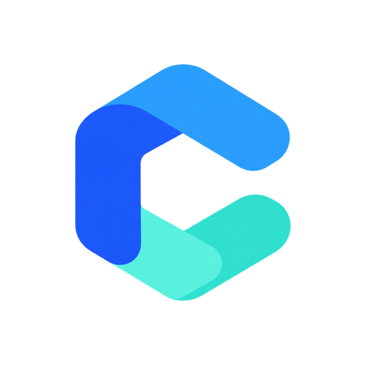
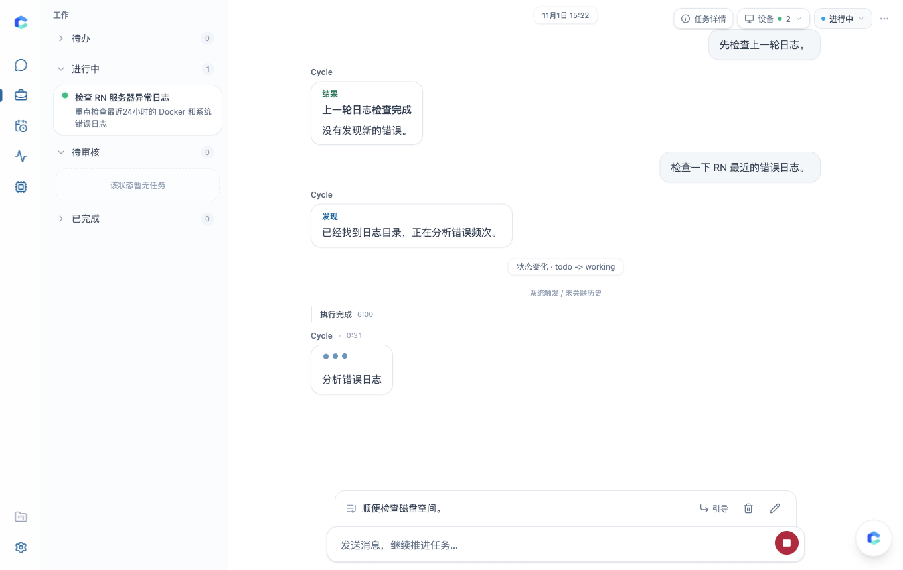
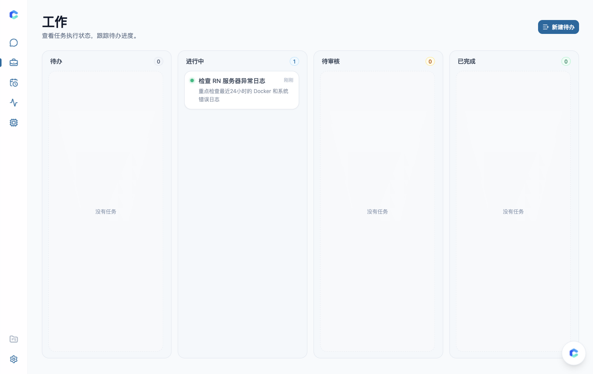
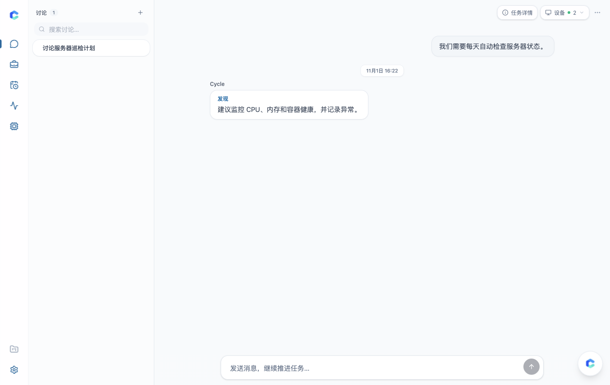
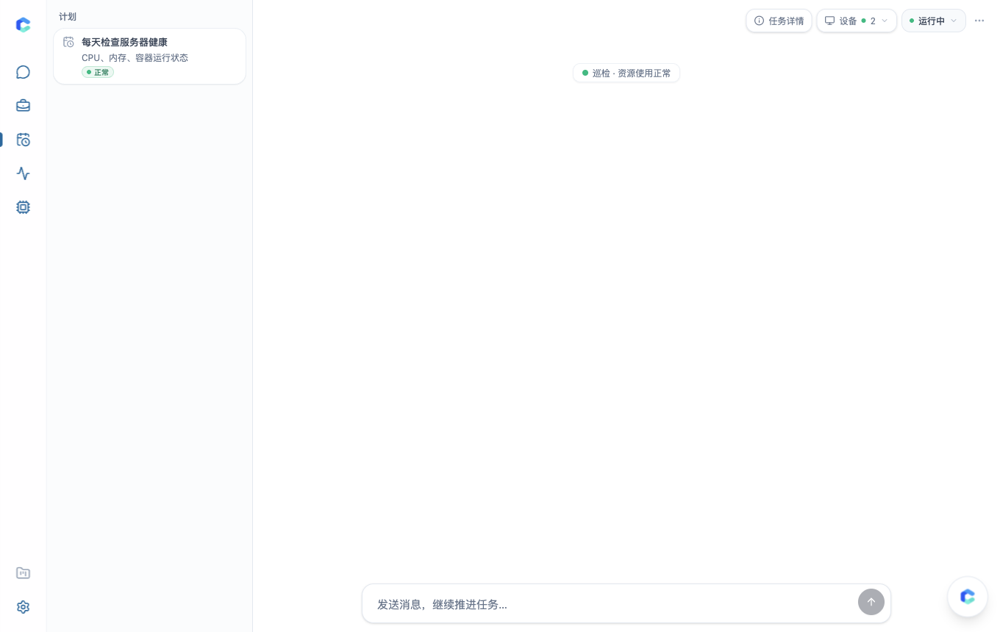

<p align="center">
  
</p>

<h1 align="center">CycleDock</h1>

<p align="center">
  <a href="README.md">English</a> | <a href="README.zh-CN.md">简体中文</a>
</p>

CycleDock is a project workspace where humans and AI collaborate around persistent cards. Instead of scattering context across temporary chat threads, each card holds its own conversation history, tool results, files, and status—from initial discussion to task execution, human review, and recurring schedules.

```text
Workspace
└── Project
    ├── Discussion  — Explore problems, run checks, and distill findings into tasks
    ├── Todo        — One-off work (Todo → Working → Review → Done; human approves Done)
    └── Ongoing     — Scheduled routines that continue in the same card and track health
```

## Interface

### Task Execution, Queue & Steer


### Project Board (`Todo → Working → Review → Done`)


### Discussion & Ongoing Schedules
| Discussion | Ongoing Schedule |
| --- | --- |
|  |  |

## Core Concepts

### Three Card Types

- **Discussion**
  Used for open-ended exploration, research, and troubleshooting. When you are ready to turn a discussion into actionable work, **Generate Work** creates a new **Todo** or **Ongoing** card and passes along a structured handoff summary (goals, constraints, decisions, and key findings) without copying hundreds of exploratory messages into the new card.
- **Todo**
  Used for tasks with a clear completion state (`Todo → Working → Review → Done`). AI can execute steps, call tools, attach deliverables, and move the card to **Review**. Only a human can move a card from **Review** to **Done**.
- **Ongoing**
  Used for recurring checks, monitoring, and routine maintenance (`Active / Paused / Archived`). Every scheduled trigger runs inside the same card so recent context stays continuous, and each check-in updates the card's health status (`healthy / warning / critical`).

### Day-to-Day Workflow

- **Persistent Context per Card**: Follow-up questions reuse earlier tool outputs directly without re-running read-only tools unless fresh data is needed. Long histories are compacted automatically, and large outputs are stored as versioned **Artifacts** that can be read on demand.
- **Queue or Interrupt**: When AI is already working on a card, new messages can either be **queued** to run next in order, or **interrupted** to stop the current run and redirect immediately.
- **Models, MCP Tools, and Devices**:
  - Connect ChatGPT / Grok subscription accounts or OpenAI-compatible API keys, with ordered routes for automatic failover.
  - Attach standard MCP servers, connect online personal devices via **NexusDock**, or authorize external MCP clients (such as Claude or ChatGPT) to work with your projects via OAuth.

## Quick Start

### Docker Compose

1. Create `.env` from the example template and set an administrator password (at least 12 characters):

```bash
cp .env.example .env
```

```env
CYCLEDOCK_ADMIN_PASSWORD=your-admin-password
```

If you plan to sign in with ChatGPT / Grok accounts or save MCP Bearer Tokens in the web UI, also generate two 32-byte encryption keys (`openssl rand -base64 32`) so credentials are encrypted before being stored in PostgreSQL:

```env
CYCLEDOCK_MODEL_SECRET_KEY=<base64-key>
CYCLEDOCK_CONNECTION_ENCRYPTION_KEY=<base64-key>
```

2. Start PostgreSQL, database migrations, and the CycleDock server (automatically pulls `ghcr.io/uvwt/cycledock-oss:latest`; set `CYCLEDOCK_IMAGE=ghcr.io/uvwt/cycledock-oss:v0.1.0` in `.env` to pin a version):

```bash
docker compose up -d
```

3. Open `http://127.0.0.1:8080`, sign in, and configure your model routes in **Agent Settings**.

### Local Development

Requires Go 1.26+, Node.js 24, Make, and PostgreSQL 17:

```bash
make setup
make dev
```

Open `http://127.0.0.1:5173`. See [docs/development.md](docs/development.md#本地开发) for details.

## Documentation

- [Installation & Self-Hosting](docs/install.md)
- [Product Definition](docs/product.md)
- [External AI Client Connection (MCP)](docs/ai-connect.md)
- [Architecture Overview](docs/architecture.md)
- [Session-First ADK Runtime](docs/session-first-adk.md)
- [Development Guide](docs/development.md)
