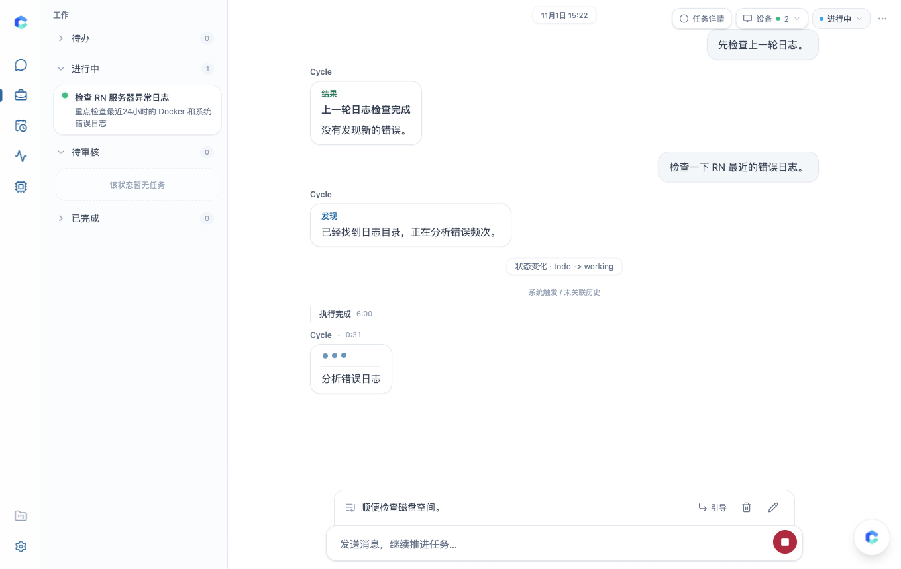
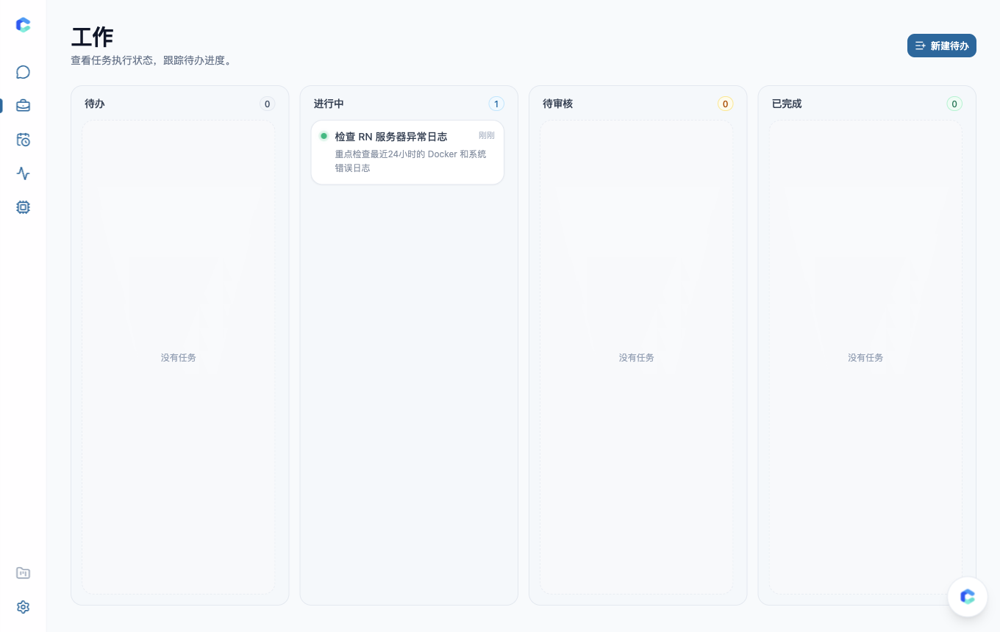
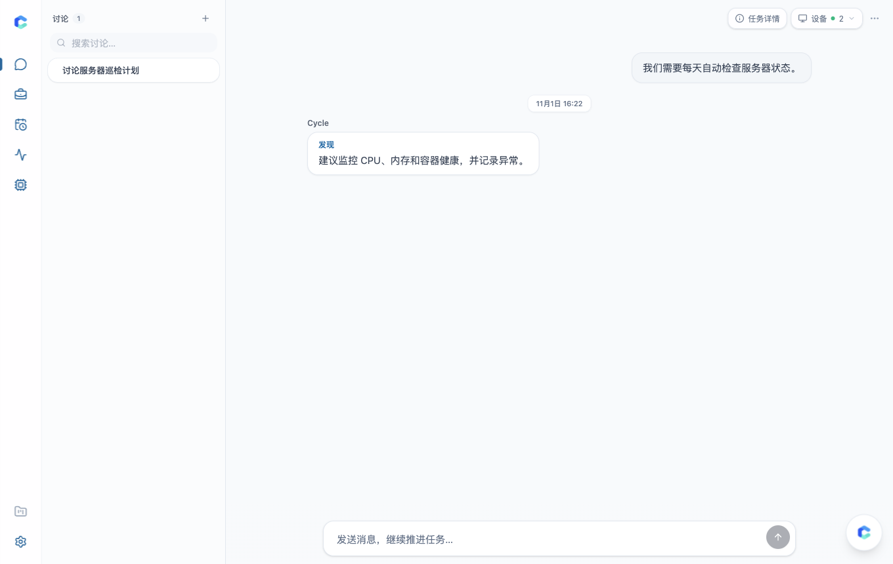
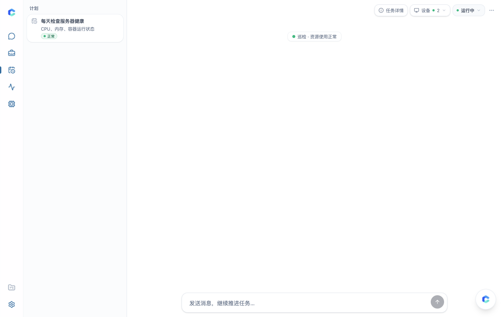

<p align="center">
  
</p>

<h1 align="center">CycleDock</h1>

<p align="center">
  <a href="README.md">English</a> | <a href="README.zh-CN.md">简体中文</a>
</p>

CycleDock 是一个围绕「项目」与「卡片」组织的人机协作工作台。

和普通聊天窗口不同，CycleDock 里的每一张卡片都是一个持久的工作上下文。你和 AI 在卡片里查过的资料、调用过的工具、生成的报告都会保留在同一张卡片内，贯穿讨论、任务执行、人工验收到周期巡检的完整过程。

```text
工作空间 (Workspace)
└── 项目 (Project)
    ├── 讨论 (Discussion)  — 理清问题与方案，整理结论后派生具体任务
    ├── 待办 (Todo)        — 单次任务（待处理 → 进行中 → 待验收 → 已完成，由人确认完成）
    └── 长期任务 (Ongoing) — 定时执行的巡检与维护任务，持续记录运行结果与健康状态
```

## 界面概览

### 任务执行、排队与实时引导


### 项目看板（待办 → 进行中 → 待审核 → 已完成）


### 讨论与长期巡检计划
| 讨论工作台 | 长期计划与健康状态 |
| --- | --- |
|  |  |

## 卡片类型与使用方式

### 1. 讨论（Discussion）

用于前期探索、查资料、排查问题或敲定方案。

当讨论有了明确结论，点击**生成任务**，系统会把讨论中的目标、约束条件和关键结论整理成一份交接摘要，创建一张新的「待办」或「长期任务」卡片，避免把前期冗长的讨论过程直接带进后续执行。

### 2. 待办（Todo）

用于有明确完成标准的单次工作，状态流转固定为：

```text
待处理 (Todo) → 进行中 (Working) → 待验收 (Review) → 已完成 (Done)
```

AI 执行完成后会将卡片推进到「待验收」，并附上处理结果或产物；从「待验收」到「已完成」只能由人工确认。如果结果需要调整，直接在卡片里回复即可让 AI 继续修改。

### 3. 长期任务（Ongoing）

用于定时巡检、日常汇总和持续观察。

卡片按设定的时间计划自动触发运行，每次执行都会复用同一张卡片的上下文，并根据最近一次检查结果更新健康状态（`正常 / 警告 / 异常`）。不需运行时可随时暂停或归档。

## 日常协作特性

- **卡片内记忆连续**：在同一张卡片里追问上一轮查过的数据，AI 可以直接引用已有的工具返回结果，不必重复执行查询；当对话历史较长时，系统会自动压缩早期记录，并将长文本或大体积结果保存为可按需读取的**产物（Artifact）**。
- **执行中随时排队或转向**：当 AI 正在处理当前卡片时，你可以继续发送消息并选择**加入队列**（等当前步骤完成后按顺序执行），或选择**立即转向**（中止当前执行并按新指令处理）。
- **多模型路由与工具接入**：
  - 支持连接多个 ChatGPT / Grok 订阅账号或配置 OpenAI 兼容 API Key，按优先级排列模型路由并在失败时自动切换。
  - 支持接入标准 MCP 工具服务；可通过 **NexusDock** 授权访问你自己的在线电脑与浏览器；也可通过 OAuth 将工作台授权给 Claude、ChatGPT 等外部客户端协同操作。
- **桌面与移动端通知**：支持浏览器 Web Push 通知（含添加到主屏幕后的 iOS 设备），在任务进入「待验收」或需要人工回复时发送提醒。

## 快速开始（Docker 单机部署）

1. 复制配置文件并设置管理员登录密码（至少 12 位字符）：

```bash
cp .env.example .env
```

```env
CYCLEDOCK_ADMIN_PASSWORD=your-admin-password
```

如果需要在网页端绑定 ChatGPT / Grok 订阅账号，或在网页端保存带 Token 的 MCP 连接，需额外配置两个 32 字节 base64 密钥（可通过 `openssl rand -base64 32` 生成），服务端会用它们将凭据加密后再写入数据库：

```env
CYCLEDOCK_MODEL_SECRET_KEY=<32字节base64密钥>
CYCLEDOCK_CONNECTION_ENCRYPTION_KEY=<32字节base64密钥>
```

2. 启动数据库、自动迁移与应用服务（默认自动拉取 `ghcr.io/uvwt/cycledock:latest` 镜像；如需锁定版本可在 `.env` 中设置 `CYCLEDOCK_IMAGE=ghcr.io/uvwt/cycledock:v0.1.2`）：

```bash
docker compose up -d
```

3. 浏览器访问 `http://127.0.0.1:8080`，使用管理员密码登录，在 **Agent 设置** 中添加模型路线并开启内置 Agent 即可开始使用。

## 相关文档

- [自托管安装与配置说明](docs/install.md)
- [外部 AI 客户端连接指南](docs/ai-connect.md)
- [产品定义](docs/product.md)
- [本地开发环境说明](docs/development.md)
